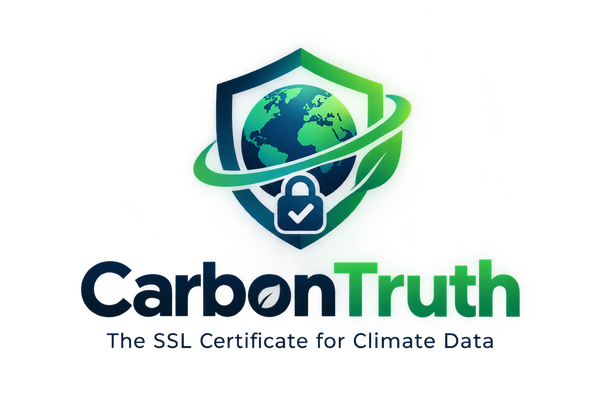

<div align="center">
  
  <h1>CarbonTruth</h1>
  <b>The SSL certificate for climate data.</b><br>
  A verification layer <i>beneath</i> the blockchain that turns raw satellite imagery into
  unforgeable, retire-once carbon credits.<br>
  <sub>Team <b>Pyragrid</b> · IEEE ClimateChain Global Hackathon 2026 · UN COP31 / Paris Article 6.4</sub>
</div>

---

## What this is

Peer-reviewed science found that **~94% of 89M forest-carbon credits were phantom** (West et al.,
*Science* 2023) and only **19% of REDD+ projects met their targets** (Tang et al., *Science* 2025).
A blockchain can't fix that — it only proves a number didn't change, not that it was ever true. That's
the **oracle problem**.

**CarbonTruth** solves the half everyone else skips. One primitive — a **Verified Climate Claim (VCC)** —
is AI-verified from independent open satellite data, anchored on-chain with an evidence hash, and made
globally unique by a geo-temporal fingerprint so a tonne can never be double-counted. One primitive maps
onto all four hackathon tracks (carbon markets, renewable energy, supply chains, climate data).

> **Verify once. Trusted everywhere.**

## This repo

```
carbontruth/
├─ index.html            # the public site + interactive app (static, deploys on Vercel)
├─ logo.png
├─ api/
│  └─ stac.js            # serverless fn: live Sentinel-2 discovery (Planetary Computer)
├─ vercel.json           # Vercel config (static site + /api function)
├─ package.json
├─ prototype/            # the real engine — pure-stdlib Python (python app.py)
│  ├─ app.py             #   satellite → model → oracle → ledger, HTTP explorer on :8017
│  ├─ ct/                #   satellite.py · model.py · oracle.py · ledger.py
│  └─ contracts/
│     └─ CarbonTruthVCC.sol   # real EVM contract: fingerprint-uniqueness + retire-once
└─ docs/
   └─ demo-video-script.md
```

The **website** runs the entire pipeline live in the browser — NDVI band math, inverse-variance
oracle fusion, SHA-256 fingerprinting, a hash-chained ledger, ownership transfer and retirement — and
you drive the whole credit lifecycle yourself: pick a project, set a claim, submit it to the oracle
network, mint it, trade it, retire it (download the certificate), and try to forge the ledger.

The **prototype/** folder is the same logic as a zero-dependency Python service, so the demo is backed
by real code, not a mock-up.

## Deploy to Vercel

**One-click (dashboard):**
1. Push this repo to GitHub (see below).
2. On [vercel.com](https://vercel.com) → **Add New → Project** → import the `carbontruth` repo.
3. Framework preset: **Other** (no build step). Leave Build & Output empty. Click **Deploy**.

That's it — `index.html` is served at `/`, and `api/stac.js` becomes `https://<you>.vercel.app/api/stac`.

**CLI:**
```bash
npm i -g vercel
vercel          # preview
vercel --prod   # production
```

## Run the Python engine locally

```bash
cd prototype
python app.py              # → http://127.0.0.1:8017
python app.py --selftest   # honest ✓ · duplicate blocked ✗ · inflated rejected ✗
```
No `pip install`, no API keys — Python standard library only (tested on 3.14).

## How it works

| Stage | File | What it does |
|---|---|---|
| **Observe** | `ct/satellite.py` | `NDVI = (B08 − B04)/(B08 + B04)`; live Sentinel-2 via Planetary Computer |
| **Estimate** | `ct/model.py` | NDVI → biomass → CO₂e; counterfactual baseline → **additional** only |
| **Verify** | `ct/oracle.py` | inverse-variance fusion `μ = Σwᵢmᵢ/Σwᵢ`, mint iff `V = 1 − |μ−c|/c ≥ 0.90` and k-of-n agree |
| **Mint** | `ct/ledger.py` | SHA-256 hash chain; fingerprint `f = H(geohash‖date‖projectID‖k)`; retire-once `R ∩ A = ∅` |

## Evidence
- West, T. et al. (2023) *Science* — doi:10.1126/science.ade3535
- Tang, F. et al. (2025) *Science* — doi:10.1126/science.adw4094
- Chave, J. et al. (2014) *Global Change Biology* — doi:10.1111/gcb.12629
- IPCC carbon fraction CF = 0.47; Sentinel-2 / NASA GEDI / Landsat open data

> **Scope honesty:** the logic is real; satellite pixels are a bundled representative scene and the
> NDVI→biomass relation is a transparent prototype estimator, not a field-calibrated model. Dollar and
> tonne figures illustrate the method. The production gap is field data and calibration — not the architecture.

---
<div align="center"><sub>CarbonTruth · Team Pyragrid · 2026 — every tonne, verified once.</sub></div>
